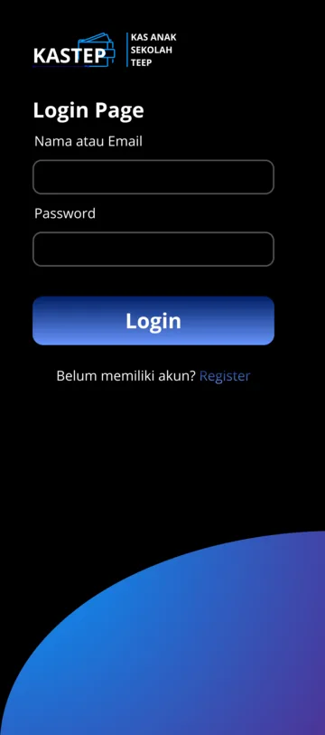
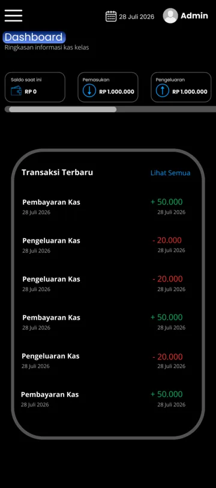
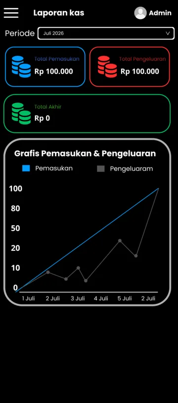
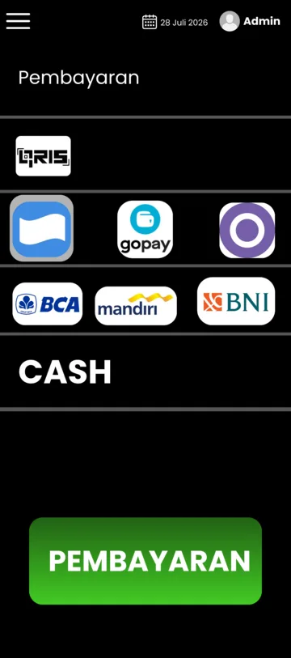

# KasTep

Aplikasi Android untuk mencatat kas kelas XII PPLG, SMKN 2 Kuta Selatan. Dibuat oleh Kelompok 1. Semua data tersimpan di HP, jadi aplikasi tetap jalan tanpa internet.

[](https://github.com/zynxx24/KasTep/releases/latest)


**[Unduh APK terbaru](https://github.com/zynxx24/KasTep/releases/latest)**

<p>
  
  
  
  
</p>
<sub>Gambar dari desain Figma di folder <code>Design/</code>.</sub>

## Cara kerja kas di aplikasi ini

- Kas Rp5.000 setiap hari Senin. Tagihan satu bulan = jumlah Senin di bulan itu × Rp5.000, jadi bisa Rp20.000 atau Rp25.000.
- Bulan yang belum lunas kena denda Rp5.000 untuk setiap bulan keterlambatan. Bulan yang sedang berjalan belum didenda.
- Minggu dispensasi dihitung lunas.
- Hanya bendahara (akun Admin) yang bisa menandai pembayaran. Siswa membayar lewat QRIS, e-wallet, bank atau tunai, lalu mengirim konfirmasi ke bendahara lewat WhatsApp dari aplikasi.

## Fitur

Menu samping berisi tujuh halaman:

| Halaman | Isi |
|---|---|
| Dashboard | Saldo, pemasukan, pengeluaran, garis progres, 10 transaksi terbaru |
| Data Siswa | Tabel 33 siswa dengan status per bulan. Siswa hanya melihat status dirinya sendiri; Admin bisa tambah, ubah dan hapus |
| Pembayaran | Pilih metode, lihat nomor tujuan atau QRIS, kirim konfirmasi WhatsApp. Admin mencatat pembayaran satu bulan atau rentang bulan |
| Riwayat Bayar | Semua pembayaran, 8 baris per halaman |
| Pengeluaran | Catat, ubah dan hapus pengeluaran (Admin) |
| Laporan Kas | Filter periode, grafik batang pemasukan dan pengeluaran 6 bulan, rincian siapa yang belum bayar, tombol bagikan laporan |
| Mata Pelajaran | Jadwal pelajaran dan alokasi jam |

Data awal berisi 33 siswa dan isi buku kas asli kelas, jadi aplikasi langsung menampilkan angka yang sama dengan buku kas.

## Build dari source

Butuh JDK 17 dan Android SDK 34 (cara termudah: buka folder ini di Android Studio).

```bash
git clone https://github.com/zynxx24/KasTep.git
cd KasTep
./gradlew assembleDebug
# hasilnya: app/build/outputs/apk/debug/app-debug.apk
```

## Struktur kode

```
app/src/main/java/com/kastep/app/
├── MainActivity.kt        menu samping dan navigasi
├── data/
│   ├── KastepModels.kt     bentuk data (Siswa, PaymentRecord, Pengeluaran, ...)
│   ├── KastepRepository.kt rumus kas dan denda, simpan ke SharedPreferences
│   └── KastepViewModel.kt  penghubung data dan layar
└── ui/
    ├── navigation/         NavGraph
    ├── screens/            satu file per layar
    └── theme/              warna dan tipografi
```

Arsitekturnya MVVM: layar Compose membaca `StateFlow` dari `KastepViewModel`, dan `KastepRepository` menyimpan semuanya sebagai JSON (Gson) di SharedPreferences.

## Untuk presentasi

Empat dokumen ini dibuat untuk menjawab pertanyaan guru saat presentasi:

- [PETA-LAYAR.md](PETA-LAYAR.md): yang terlihat di layar, beserta file dan nomor barisnya
- [TANYA-JAWAB.md](TANYA-JAWAB.md): perkiraan pertanyaan beserta jawaban dan letak kodenya
- [KAMUS-KODE.md](KAMUS-KODE.md): arti istilah Kotlin dan Compose dengan bahasa sederhana
- [PETA-KODE.md](PETA-KODE.md): daftar penanda `CARI-...` dan `TANYA-GURU` di kode

Setiap file `.kt` diawali blok `BACA INI DULU`. Di Android Studio, tekan Ctrl+Shift+F lalu cari `TANYA-GURU`.

Aplikasi saudaranya: [AppCash](https://github.com/zynxx24/AppCash) (Kelompok 6) dan [KasKu](https://github.com/zynxx24/kasku) (Kelompok 8).
